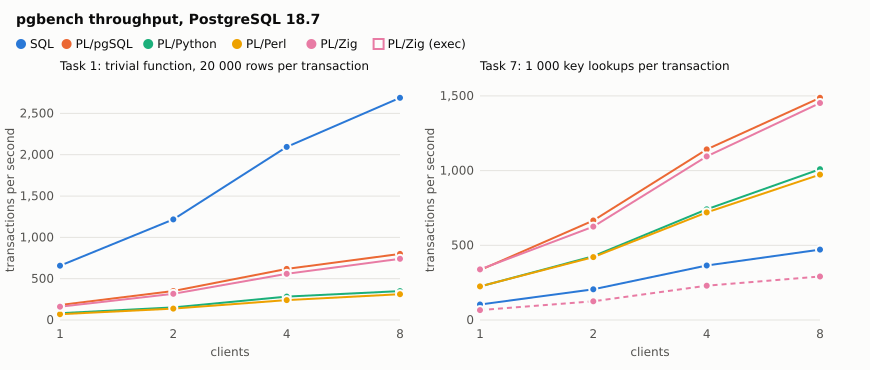

# PL/Zig benchmarks

Generated by `bench/report.py` from the run of 2026-11-14 17:13:33 +0000 (full mode). Raw data: [`doc/benchmarks/`](benchmarks/) (CSV per PostgreSQL version). Reproduce with `bench/run.sh` (see `bench/README.md`). All numbers come from **one machine** (below); absolute times will differ elsewhere, ratios less so.

<!-- the analysis below is bench/notes.md, written by hand after looking at the numbers -->
## Read this first

* **One machine, one run per version.** A laptop-class CPU (hybrid
  performance/efficiency cores; the benchmark container was pinned to the
  six performance cores, 12 hardware threads) with frequency scaling left
  on. Ratios between languages are more meaningful than absolute times.
* **PL/Python (`plpython3u`) is untrusted and unsandboxed**: its functions
  run with the full rights of the server OS user. It is here as a speed
  reference, not as a like-for-like alternative to PL/Zig. **PL/Perl
  (`plperl`) is the trusted variant**, which runs code in `Safe`
  compartments (for example `pack`/`unpack` are not available, see task 5).
  PL/Zig is trusted and runs every function in a WebAssembly sandbox,
  executed by an **interpreter** (WAMR classic interpreter, no JIT or AOT,
  by design: PLAN.md D2).
* **Trigger and set-returning workloads are absent** because PL/Zig v1
  supports neither (README, *Not supported*).
* Every implementation is meant to be idiomatic for its language, with
  prepared plans where the language has them (PL/pgSQL caches plans by
  itself). Where the obvious code is a known trap, the trap was avoided and
  the file says so: PL/pgSQL string building appends to an array instead of
  `s := s || x` (quadratic), and task 5/10 values are passed as in-memory
  values (PL/pgSQL would re-read a TOASTed argument on every `get_byte()`).
  The SQL column is a reference: in task 6 it is C code from contrib, in
  tasks 7 and 9 a set-based statement.
* Before timing, a **correctness gate** compares every implementation's
  result with PL/pgSQL's; the run stops if any differs.

## What the numbers say

(The figures quoted in this section are those of the published run in
`doc/benchmarks.md`, PostgreSQL 18.7, JIT off.)

**Where PL/Zig wins: computation inside one call.** Integer loops (task 2
primes: 0.28× PL/pgSQL's time), floating point (Mandelbrot row: 0.21×), a
checksum loop over a 1 MB `bytea` (task 5: 0.23×) and edit distance against
10 000 rows fetched through a cursor (task 6: 0.57×). In all of these PL/Zig
is also faster than PL/Python and PL/Perl (1.7–4× on task 2, 6–8× on task 5). This is
the case the design predicts: compiled Zig is interpreted at roughly
10–15 ns per byte for a simple loop (task 5: 11 ms for 1 MB; one call), which
beats PL/pgSQL's per-statement expression evaluation, but is far from native
code: compiled C would be one to two orders of magnitude faster still.

**About even: SPI-heavy loops with prepared statements.** Task 7 (100 000
lookups by key: 1.06×), task 9 (20 000 inserts + 20 000 updates: 1.06×), and
under concurrency (pgbench task 7: within 10 % of PL/pgSQL at 1–8 clients).
The time goes into the executor, which every language shares; PL/Zig's
boundary crossing (host import, typed parameter and row encoding) costs about
as much as PL/pgSQL's own statement overhead. Without a prepared statement
(`spi.execute`: parse, plan, text parameters, text result for every lookup)
PL/Zig is 5.8× slower than with one: prepare anything that runs in a loop.

**Where PL/Zig loses, and why (measured, see *Profiling*):**

* **Per-call overhead (task 1: 1.65× PL/pgSQL, ~0.39 µs per call against
  ~0.24 µs).** Each call creates and deletes two memory contexts and enters
  the interpreter three times (`plzig_begin`, `plzig_alloc`, `plzig_call`);
  the guest's own work for `x + 1` is negligible. PL/Zig is still faster per
  call than PL/Python and PL/Perl here.
* **Row-at-a-time cursor loops (task 8: 1.76×).** Every row crosses the
  boundary twice (`spi_cursor_next` for the size, `spi_cursor_read` for the
  encoded row) and is converted into a per-row buffer; ~0.3 µs per row
  against ~0.17 µs for PL/pgSQL's `FOR r IN SELECT`.
* **String building with `std.fmt` (task 3: 4.1×) and parsing (task 4:
  2.1×).** Here the competitors run their inner work in C: PL/pgSQL's
  `string_to_array`, `btrim`, `lower` and regular expressions, Perl's and
  Python's string primitives. PL/Zig runs it all as interpreted code: task 4
  makes about four passes over ~9 MB of input at ~13–23 ns per byte and pass
  (a loop that only counts commas already costs 13 ns per byte), and in
  `ReleaseSafe` every allocation is first filled with `0xAA` byte by byte
  (another ~8 ns per byte for the output buffer). Formatting an integer with
  `std.fmt` costs about 0.8 µs in the interpreter (task 3: 200 000 items,
  168 ms). PL/Python is 4× faster than PL/Zig on task 4 and 6× on task 3.
* **Large values (task 10): 1.13× for `bytea`, 1.30× for `text`.** One copy
  in, one copy out (plus the arena), and `text` results are validated
  (UTF-8, no NUL), which PL/pgSQL, returning its argument unchanged, does
  not need to do. Before this phase these were 20× and 8× (see *Task 10
  before and after*).
* **Start-up and compile (task 11).** The first call in a new session costs
  ~1.2 ms (WAMR initialisation, reading and validating the cached module,
  instantiation) against ~0.4 ms for PL/pgSQL, but less than the ~7–8 ms that
  PL/Python and PL/Perl need to start their interpreters. `CREATE FUNCTION`
  compiles: **~165 ms with a warm Zig cache, ~1.9 s with a cold one** (the
  first function of a new cluster, or after the Zig cache directory is
  removed), against well under a millisecond for PL/pgSQL. Compilations are
  serialised cluster-wide (PLAN.md D9), so a deployment that creates many
  PL/Zig functions at once waits for them one after the other.
* **Memory (task 12).** The peak increase per backend is small for every
  language in tasks 6 and 8 (≤ 3 MB). In task 3 PL/Zig's guest memory (the
  1.4 MB result built in the arena, then copied out) adds ~8 MB at peak, less
  than PL/pgSQL (~19 MB: array of 200 000 elements, then the joined string)
  and SQL (~20 MB). Guest linear memory never shrinks; an instance that grew
  beyond `plzig.instance_cache_max_memory` (4 MB) is destroyed after the call.

**JIT** makes no measurable difference to any language here: with the
default thresholds only the outer statement of task 1's PL variants is
compiled (its cost estimate counts 100 per function call), and the time is
in the function calls, which JIT does not touch. Forcing JIT for every
statement only adds compile time (task 8's SQL baseline: 1.5×).

**Concurrency (pgbench).** Every language scales similarly from 1 to 4
clients; at 8 clients the six physical cores (shared with the pgbench
threads) are saturated. PL/Zig's relative position matches the
single-session results.

## Profiling and what was changed

`bench/run.sh --profile` (perf, user-space cycles) on tasks 1, 8 and 10 at
the start of this phase:

1. **Fixed (guest SDK, no host or ABI change).** 97 % of an identity
   function on a 1 MB `bytea`, and 70 % of a trivial call, were spent in the
   interpreter. Cause: `plzig_alloc`, which the host calls to obtain the
   argument block of every call, used `Allocator.alignedAlloc`, which in
   `ReleaseSafe` fills the new block with `0xAA` — byte by byte in the
   interpreter, ~10 ns per byte — before the host overwrites it. It now uses
   the allocator's `rawAlloc`. Task 1 went from ~0.77 to ~0.37 µs per call (quick-mode runs);
   task 10 from 262/225 ms to 52/21 ms (text/bytea).
2. **PLAN.md §12 item 6 (host).** `text`/`bytea` results and SPI `text`
   parameters are copied once, straight into the final value, and
   validated there (rules unchanged). Task 10: text 52.0 → 44.2 ms, bytea
   21.1 → 12.2 ms.
3. **Explained, not changed:** the remaining per-call cost (task 1: ~35 %
   interpreter entry for three guest calls, ~15–20 % creating and deleting
   the per-call memory contexts) and the per-row cost of cursors (task 8:
   two host calls and native-call trampolines per row, per-row conversion).
   Both would need ABI or lifetime changes in security-relevant host code.

## Recommendations (not done: they change the interpreter configuration or the ABI)

* **Enable the bulk-memory proposal** (WAMR build and `-mcpu` for guests):
  `memory.copy`/`memory.fill` would turn every guest `memcpy`/`memset`
  (including `ReleaseSafe`'s `0xAA` fill of each allocation) into one native
  operation instead of an interpreted byte loop. Expected to help tasks 3
  and 4 most. It enlarges the interpreter surface a little; needs a security
  review.
* **WAMR fast interpreter or AOT** would change the compute picture by a
  large factor; D2 rejected both for code-size and attack-surface reasons.
  If ever reconsidered, these numbers are the baseline.
* **One guest entry per call** (an ABI where `plzig_call` resets the arena
  and receives the argument size) and **one host call per cursor row**
  (`next` writing into a guest buffer that the guest grows on demand) would
  remove roughly a third of the per-call and per-row overhead.
* **Reuse the per-call memory contexts** instead of creating and deleting
  two per call (needs care with recursion and error paths).

## Machine, versions, settings

| | |
|---|---|
| CPU | Intel(R) Core(TM) Ultra 7 155H; 22 logical CPUs, benchmark container pinned to 0-11 (12 visible) |
| Memory | 93.9 GB |
| Kernel | Linux 7.2.15-200.fc44.x86_64; CPU frequency governor: powersave |
| OS (container) | Debian 12.15 (`postgres:<version>-bookworm`, PGDG packages) |
| PostgreSQL | PostgreSQL 18.7 (Debian 18.7-1.pgdg12+2) on x86_64-pc-linux-gnu, compiled by gcc (Debian 12.2.0-14+deb12u1) 12.2.0, 64-bit |
| Languages | PL/Zig 1.0 with Zig 0.17.1 (WAMR 2.4.5 classic interpreter); PL/Python with Python 3.11.2; PL/Perl with Perl v5.36.0; PL/pgSQL and SQL of the server |
| JIT | LLVM, available; measured off, with the server default (on, `jit_above_cost` = 100000) and forced (see *JIT*) |
| Runs | 3 warm-up + 15 timed runs per task and implementation, interleaved round-robin across implementations, each implementation in its own session |

Server settings (identical for every language; everything else is the default):

| Setting | Value |
|---|---|
| `autovacuum` | off |
| `listen_addresses` |  |
| `log_min_messages` | warning |
| `maintenance_work_mem` | 262144kB |
| `max_connections` | 100 |
| `max_parallel_workers_per_gather` | 0 |
| `shared_buffers` | 512MB |
| `synchronous_commit` | off |
| `work_mem` | 65536kB |
| PL/Zig settings | only `plzig.zig_path` set; everything else at its default (README, *Configuration*) |

Data sizes: big_rows = 1000000, words = 10000, csv_rows = 20000, blob_kb = 1024.

## Single-session results, PostgreSQL 18.7, JIT off

Median wall-clock time of the whole statement (client side, ms); below it the spread as interquartile range, and the time relative to PL/pgSQL. Lower is better. SQL is the plain-SQL baseline where one is expressible (task 6: `levenshtein()` from contrib/fuzzystrmatch, C code; tasks 7 and 9: set-based, not a loop).

| Task | SQL | PL/pgSQL | PL/Python | PL/Perl | PL/Zig | PL/Zig (exec) |
|---|---:|---:|---:|---:|---:|---:|
| 1. Trivial function over N rows | **53.5** 51.0–54.0 0.23× | **236** 225–238 1.00× | **570** 541–577 2.41× | **651** 643–658 2.75× | **390** 384–395 1.65× | – |
| 2. Integer and float loops — mandelbrot | – | **154** 153–155 1.00× | **92.6** 86.6–93.0 0.60× | **133** 133–134 0.87× | **33.0** 32.8–33.2 0.21× | – |
| 2. Integer and float loops — primes | **798** 776–808 3.19× | **250** 240–257 1.00× | **117** 112–118 0.47× | **136** 135–139 0.54× | **69.5** 68.5–72.1 0.28× | – |
| 3. String building and concatenation | **36.6** 36.3–36.7 0.90× | **40.8** 40.4–41.0 1.00× | **26.6** 26.3–27.1 0.65× | **11.2** 11.1–11.8 0.27× | **168** 166–170 4.11× | – |
| 4. Parsing: split a CSV line, validate and normalise identifiers | **353** 349–355 1.20× | **295** 293–298 1.00× | **145** 145–146 0.49× | **797** 794–805 2.71× | **615** 613–619 2.09× | – |
| 5. Checksum (32-bit FNV-1a) of a bytea | – | **48.5** 48.1–49.1 1.00× | **66.3** 65.9–66.6 1.37× | **88.3** 87.5–90.8 1.82× | **11.2** 10.8–11.5 0.23× | – |
| 6. Edit distance against each row of a query result | **2.28** 2.22–2.30 0.01× | **213** 211–215 1.00× | **165** 164–167 0.77× | **204** 204–207 0.96× | **121** 120–121 0.57× | – |
| 7. Many small lookups by key in a loop | **27.0** 26.3–27.6 0.10× | **262** 254–268 1.00× | **396** 394–408 1.51× | **422** 417–428 1.61× | **277** 269–278 1.06× | **1,516** 1,504–1,531 5.78× |
| 8. Row-by-row aggregation over a large result | **43.0** 42.1–43.3 0.26× | **167** 166–169 1.00× | **252** 240–253 1.50× | **1,212** 1,200–1,218 7.25× | **295** 295–297 1.76× | – |
| 9. Insert/update loop | **57.1** 55.3–58.0 0.36× | **158** 157–163 1.00× | **251** 249–254 1.59× | **243** 242–246 1.54× | **167** 167–173 1.06× | – |
| 10. Large text/bytea argument in and out (identity function) — bytea_1MB | **9.78** 9.51–10.1 0.90× | **10.9** 10.7–11.4 1.00× | **8.05** 7.98–8.28 0.74× | **74.4** 73.7–75.1 6.83× | **12.3** 11.8–13.2 1.13× | – |
| 10. Large text/bytea argument in and out (identity function) — text_1MB | **32.6** 32.1–32.9 0.98× | **33.3** 33.1–33.6 1.00× | **54.3** 53.7–54.6 1.63× | **64.6** 64.4–65.2 1.94× | **43.2** 42.6–43.8 1.30× | – |

## JIT

JIT compilation only ever applies to the SQL expressions of a statement (the outer query, and queries a function runs through SPI), never to the PL code itself. *on* is the server default (`jit = on`, `jit_above_cost` = 100000): a statement is compiled only if its estimated cost exceeds that. *force* sets all three JIT thresholds to 0 (every statement compiled; nobody would run like that) and was measured for the SQL-heavy tasks only.

From a separate run of the SQL-heavy tasks 1, 2 and 8, all three modes one after the other in the same container, otherwise measured like the main run ([`benchmarks/jit/`](benchmarks/jit/)).

With *on*, EXPLAIN shows JIT for 4 of 19 timed statements: 1 x+1 (PL/Perl), 1 x+1 (PL/Python), 1 x+1 (PL/Zig), 1 x+1 (PL/pgSQL) (highest estimated cost: 270,406, task 1 PL/pgSQL). (EXPLAIN covers the outer statement; statements run inside the functions are planned and JIT-decided separately.)

Median ms; rows where no mode differs from *off* by more than 10 % are left out.

| Task | Implementation | off | on | force |
|---|---|---:|---:|---:|
| 8 cursor_sum | SQL | 41.4 | 42.8 (1.03×) | 61.9 (1.50×) |

## Concurrency (pgbench), PostgreSQL 18.7, JIT off

`pgbench -M prepared -T 15` with one statement per transaction; clients = threads; client and server share the 12 CPUs of the container (6 physical cores with 2 hardware threads each). Transactions per second (higher is better) and average latency.

| Task | Implementation | 1 clients: tps (latency ms) | 2 clients: tps (latency ms) | 4 clients: tps (latency ms) | 8 clients: tps (latency ms) |
|---|---|---:|---:|---:|---:|
| 1 | SQL | 637 (1.57) | 1,138 (1.76) | 1,969 (2.03) | 2,599 (3.08) |
| 1 | PL/pgSQL | 178 (5.62) | 340 (5.88) | 583 (6.86) | 611 (13.08) |
| 1 | PL/Python | 84 (11.89) | 159 (12.61) | 281 (14.22) | 357 (22.44) |
| 1 | PL/Perl | 72 (13.83) | 140 (14.27) | 246 (16.23) | 324 (24.68) |
| 1 | PL/Zig | 118 (8.45) | 226 (8.85) | 403 (9.92) | 528 (15.16) |
| 7 | SQL | 102 (9.79) | 194 (10.29) | 347 (11.53) | 402 (19.92) |
| 7 | PL/pgSQL | 325 (3.08) | 574 (3.48) | 1,058 (3.78) | 1,458 (5.49) |
| 7 | PL/Python | 232 (4.31) | 454 (4.40) | 783 (5.11) | 1,064 (7.52) |
| 7 | PL/Perl | 224 (4.47) | 423 (4.73) | 723 (5.53) | 998 (8.02) |
| 7 | PL/Zig | 331 (3.02) | 630 (3.18) | 1,087 (3.68) | 1,416 (5.65) |
| 7 | PL/Zig (exec) | 63 (15.96) | 123 (16.31) | 214 (18.73) | 293 (27.34) |

## Task 11: start-up and compile cost, PostgreSQL 18.7

Median ms (min–max). *New session*: connect (not timed), then the first call of a trivial function whose code is already compiled/cached, and the second call. *After CREATE*: in a new session, `CREATE FUNCTION` of a body that has never been compiled (a unique comment), then its first call. PL/Zig compiles in `CREATE FUNCTION` (validator) and stores the module in the cache, so the first call only loads it. *Cold Zig cache*: the compiler's own cache (`$PGDATA/plzig/pgsql_tmp.zig-cache`, the compiled standard library) deleted before each run — what the first PL/Zig function of a new cluster, or the first after that directory is lost, costs. For PL/Python and PL/Perl the *after CREATE* numbers include starting the interpreter, because the validator runs in a fresh session.

| | SQL | PL/pgSQL | PL/Python | PL/Perl | PL/Zig |
|---|---:|---:|---:|---:|---:|
| new session: first call | 0.163 (0.146–0.308) | 0.409 (0.360–0.707) | 7.84 (7.07–8.66) | 6.98 (6.54–8.11) | 1.23 (1.19–2.27) |
| new session: second call | 0.024 (0.021–0.044) | 0.030 (0.026–0.040) | 0.045 (0.041–0.093) | 0.041 (0.036–0.240) | 0.037 (0.030–0.059) |
| after CREATE: CREATE FUNCTION | 0.204 (0.187–0.389) | 0.425 (0.378–0.562) | 7.64 (7.25–9.56) | 6.84 (6.53–11.1) | 165 (159–266) |
| after CREATE: first call | 0.074 (0.067–0.118) | 0.141 (0.126–0.341) | 0.130 (0.104–0.178) | 0.123 (0.106–0.142) | 0.446 (0.415–0.646) |
| cold Zig cache: CREATE FUNCTION | – | – | – | – | 1,865 (1,765–1,952) |
| cold Zig cache: first call | – | – | – | – | 0.479 (0.423–0.721) |

## Task 12: backend memory high-water mark, PostgreSQL 18.7

`VmHWM` (peak resident set) of the backend from `/proc/<pid>/status`, in a fresh session: *before* is after loading the language (a trivial call) and reading the task's table once (so shared buffers already touched are in the baseline), *after* is after one run of the task; median of the runs, MB. The increase is the extra peak memory the task needed; it includes private memory of the executor, the language runtime and, for PL/Zig, the guest's linear memory.

| Task | SQL: before → after (+increase) | PL/pgSQL: before → after (+increase) | PL/Python: before → after (+increase) | PL/Perl: before → after (+increase) | PL/Zig: before → after (+increase) |
|---|---:|---:|---:|---:|---:|
| 3. String building and concatenation | 18.3 → 38.3 (+20.0) | 21.4 → 40.2 (+18.8) | 28.5 → 44.5 (+16.0) | 25.0 → 33.1 (+8.1) | 22.5 → 30.4 (+7.9) |
| 6. Edit distance against each row of a query result | 20.8 → 24.1 (+3.2) | 24.0 → 24.8 (+0.8) | 31.5 → 34.6 (+3.1) | 28.0 → 28.3 (+0.2) | 25.4 → 26.8 (+1.4) |
| 8. Row-by-row aggregation over a large result | 84.3 → 84.9 (+0.6) | 87.4 → 88.0 (+0.6) | 94.9 → 95.6 (+0.7) | 91.4 → 91.5 (+0.1) | 88.8 → 90.0 (+1.2) |

## Task 10 before and after the copy changes

Separate runs of task 10 only (same method, same machine, minutes apart), one per state of the code; median ms (interquartile range) for 20 calls with a 1 MB argument and a 1 MB result each.

| State | text_1MB: PL/Zig | text_1MB: PL/pgSQL | bytea_1MB: PL/Zig | bytea_1MB: PL/pgSQL |
|---|---:|---:|---:|---:|
| HEAD (82168e3) before phase D | 262 (261–267) | 32.9 (32.9–33.0) | 225 (223–229) | 11.9 (11.5–12.1) |
| + SDK plzig_alloc without the 0xAA fill | 52.0 (51.1–52.9) | 32.4 (32.1–33.2) | 21.1 (20.9–21.6) | 10.7 (10.6–11.6) |
| + PLAN §12 item 6 (one copy for text/bytea results and SPI text parameters) | 44.2 (43.7–45.6) | 34.1 (33.8–35.2) | 12.2 (12.0–12.3) | 11.4 (11.3–11.6) |

## Cross-version run

Same tasks on the other versions (JIT off; see each version's meta.json for its run count). Median ms for PL/Zig and PL/pgSQL and their ratio; the full tables are in the CSV files.

| Task | 18.7: PL/Zig / PL/pgSQL (ratio) | 14.25: PL/Zig / PL/pgSQL (ratio) | 19rc2: PL/Zig / PL/pgSQL (ratio) |
|---|---:|---:|---:|
| 1 x+1 | 390 / 236 (1.65) | 396 / 251 (1.58) | 390 / 220 (1.77) |
| 2 mandelbrot | 33.0 / 154 (0.21) | 34.0 / 178 (0.19) | 31.3 / 162 (0.19) |
| 2 primes | 69.5 / 250 (0.28) | 69.5 / 251 (0.28) | 75.7 / 264 (0.29) |
| 3 build | 168 / 40.8 (4.11) | 175 / 42.3 (4.14) | 166 / 42.3 (3.92) |
| 4 csv | 615 / 295 (2.09) | 656 / 304 (2.16) | 635 / 290 (2.19) |
| 5 fnv1a | 11.2 / 48.5 (0.23) | 10.8 / 54.5 (0.20) | 11.4 / 51.0 (0.22) |
| 6 levenshtein | 121 / 213 (0.57) | 124 / 237 (0.52) | 127 / 214 (0.59) |
| 7 by_key | 277 / 262 (1.06) | 279 / 282 (0.99) | 275 / 288 (0.95) |
| 8 cursor_sum | 295 / 167 (1.76) | 321 / 185 (1.74) | 287 / 163 (1.76) |
| 9 insert_update | 167 / 158 (1.06) | 173 / 161 (1.08) | 183 / 164 (1.12) |
| 10 bytea_1MB | 12.3 / 10.9 (1.13) | 13.1 / 10.6 (1.23) | 12.5 / 10.9 (1.15) |
| 10 text_1MB | 43.2 / 33.3 (1.30) | 49.6 / 35.1 (1.41) | 47.6 / 37.8 (1.26) |

Task 11 on each version, PL/Zig, median ms:

| | 18.7 | 14.25 | 19rc2 |
|---|---:|---:|---:|
| new session: first call | 1.23 | 1.55 | 1.19 |
| CREATE FUNCTION (warm Zig cache) | 165 | 163 | 161 |
| CREATE FUNCTION (cold Zig cache) | 1,865 | 1,870 | 1,882 |

## Correctness gate

* 18.7: 59 results compared against PL/pgSQL, all identical.
* 14.25: 59 results compared against PL/pgSQL, all identical.
* 19rc2: 59 results compared against PL/pgSQL, all identical.

