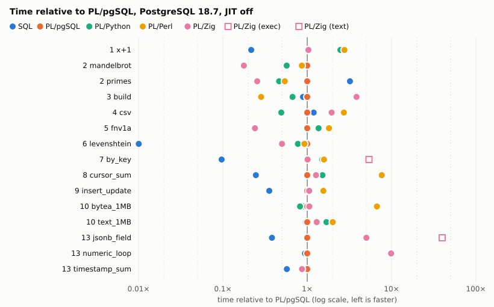
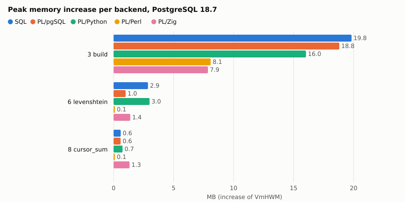

# PL/Zig benchmarks

Generated by `bench/report.py` from the run of 2026-11-15 04:28:29 +0000 (full mode). Raw data: [`doc/benchmarks/`](benchmarks/) (CSV per PostgreSQL version). Reproduce with `bench/run.sh` (see `bench/README.md`). All numbers come from **one machine** (below); absolute times will differ elsewhere, ratios less so.

<!-- the analysis below is bench/notes.md, written by hand after looking at the numbers -->
## Read this first

* **One machine, one run per version.** A laptop-class CPU (hybrid
  performance/efficiency cores; the benchmark container was pinned to the
  six performance cores, 12 hardware threads) with frequency scaling left
  on. Ratios between languages are more meaningful than absolute times.
* **PL/Python (`plpython3u`) is untrusted and unsandboxed**: its functions
  run with the full rights of the server OS user. It is here as a speed
  reference, not as a like-for-like alternative to PL/Zig. **PL/Perl
  (`plperl`) is the trusted variant**, which runs code in `Safe`
  compartments (for example `pack`/`unpack` are not available, see task 5).
  PL/Zig is trusted and runs every function in a WebAssembly sandbox,
  executed by an **interpreter** (WAMR classic interpreter, no JIT or AOT,
  by design: PLAN.md D2).
* **Trigger and set-returning workloads are absent** because PL/Zig v1
  supports neither (README, *Not supported*).
* Every implementation is meant to be idiomatic for its language, with
  prepared plans where the language has them (PL/pgSQL caches plans by
  itself). Where the obvious code is a known trap, the trap was avoided and
  the file says so: PL/pgSQL string building appends to an array instead of
  `s := s || x` (quadratic), and task 5/10 values are passed as in-memory
  values (PL/pgSQL would re-read a TOASTed argument on every `get_byte()`).
  The SQL column is a reference: in task 6 it is C code from contrib, in
  tasks 7 and 9 a set-based statement.
* Before timing, a **correctness gate** compares every implementation's
  result with PL/pgSQL's; the run stops if any differs.

## What the numbers say

(The figures quoted in this section are those of the published run in
`doc/benchmarks.md`, PostgreSQL 18.7, JIT off.)

**Where PL/Zig wins: computation inside one call.** Integer loops (task 2
primes: 0.26× PL/pgSQL's time), floating point (Mandelbrot row: 0.18×), a
checksum loop over a 1 MB `bytea` (task 5: 0.24×) and edit distance against
10 000 rows fetched through a cursor (task 6: 0.50×). In all of these PL/Zig
is also faster than PL/Python and PL/Perl (1.8–4.9× on task 2, 5.7–7.5× on task 5). This is
the case the design predicts: compiled Zig is interpreted at roughly
10–15 ns per byte for a simple loop (task 5: 11 ms for 1 MB; one call), which
beats PL/pgSQL's per-statement expression evaluation, but is far from native
code: compiled C would be one to two orders of magnitude faster still.

**About even: per-call overhead and SPI-heavy loops with prepared
statements.** Task 1 (one million calls of a trivial function: 1.03×, about
0.23 µs per call against 0.22 µs), task 7 (100 000 lookups by key: 1.01×),
task 9 (20 000 inserts + 20 000 updates: 1.05×), and under concurrency
(pgbench: task 7 within 2 % of PL/pgSQL at 1–8 clients, task 1 within 5 %).
For SPI the time goes into the executor, which every language shares;
PL/Zig's boundary crossing (host import, typed parameter and row encoding)
costs about as much as PL/pgSQL's own statement overhead. A call now enters
the interpreter once and reuses its instance's memory contexts (see
*Per-call and per-row overhead before and after*: task 1 went from about 1.6× to
1.03×). Without a prepared statement (`spi.execute`: parse, plan, text
parameters, text result for every lookup) PL/Zig is 5.3× slower than with
one: prepare anything that runs in a loop.

**Where PL/Zig loses, and why (measured, see *Profiling*):**

* **Row-at-a-time cursor loops (task 8: 1.27×).** Every row crosses the
  boundary once (`spi_cursor_fetch` writes it into the cursor's guest
  buffer) and is encoded on the way (one `Value` per column); ~0.19 µs per
  row against ~0.15 µs for PL/pgSQL's `FOR r IN SELECT`. Before the
  per-row change it was two host calls and a per-row allocation (about 1.7×).
* **String building with `std.fmt` (task 3: 3.8×) and parsing (task 4:
  2.0×).** Here the competitors run their inner work in C: PL/pgSQL's
  `string_to_array`, `btrim`, `lower` and regular expressions, Perl's and
  Python's string primitives. PL/Zig runs it all as interpreted code: task 4
  makes about four passes over ~9 MB of input at ~13–23 ns per byte and pass
  (a loop that only counts commas already costs 13 ns per byte), and in
  `ReleaseSafe` every allocation is first filled with `0xAA` byte by byte
  (another ~8 ns per byte for the output buffer). Formatting an integer with
  `std.fmt` costs about 0.8 µs in the interpreter (task 3: 200 000 items,
  149 ms). PL/Python is 4× faster than PL/Zig on task 4 and 6× on task 3.
* **Large values (task 10): 1.06× for `bytea`, 1.29× for `text`.** One copy
  in, one copy out (plus the arena), and `text` results are validated
  (UTF-8, no NUL), which PL/pgSQL, returning its argument unchanged, does
  not need to do. Before this phase these were 20× and 8× (see *Task 10
  before and after*).
* **Start-up and compile (task 11).** The first call in a new session costs
  ~1.2 ms (WAMR initialisation, reading and validating the cached module,
  instantiation) against ~0.4 ms for PL/pgSQL, but less than the ~7–8 ms that
  PL/Python and PL/Perl need to start their interpreters. `CREATE FUNCTION`
  compiles: **~160 ms with a warm Zig cache, ~1.8 s with a cold one** (the
  first function of a new cluster, or after the Zig cache directory is
  removed), against well under a millisecond for PL/pgSQL. Compilations are
  serialised cluster-wide (PLAN.md D9), so a deployment that creates many
  PL/Zig functions at once waits for them one after the other.
* **Memory (task 12).** The peak increase per backend is small for every
  language in tasks 6 and 8 (≤ 3.1 MB). In task 3 PL/Zig's guest memory (the
  1.4 MB result built in the arena, then copied out) adds ~8 MB at peak, less
  than PL/pgSQL (~19 MB: array of 200 000 elements, then the joined string)
  and SQL (~20 MB). Guest linear memory never shrinks; an instance that grew
  beyond `plzig.instance_cache_max_memory` (4 MB) is destroyed after the call.

**The natively mapped types (task 13, added with ABI version 4).** A
`timestamp` column summed over a cursor (100 000 rows) takes 0.87× PL/pgSQL's
time: the raw value arrives in the row's `Value`, nothing is formatted or
parsed. One field of a jsonb document per row (100 000 rows, `doc ->>
'qty'`) is 5.0× (1.4 µs per row against 0.29 µs): the document is copied
into the guest once and read in place (container header, a pass over the
keys, the on-disk numeric converted in place); through the text
representation (a domain over `jsonb`: `jsonb_out` on the host, a scan in
the guest) it is 40×. Numeric arithmetic in a loop (200 000 iterations of
`s + i * 1.25`) is 9.9×: two host calls per iteration, each validating its
operands with `numeric_recv` and converting the result with
`numeric_send`, about 0.6 µs per operation against PL/pgSQL working on
`Numeric` values directly. Exactness and the never-trust-the-guest rule
cost this; use `i64`/`f64` in a hot loop where the values allow it.

These figures are after the hot-path work of PLAN.md Deviations 30: the
first published run of task 13 had 34× and 52×. Most of that was the
interpreter's block-address cache (64 sets by default) missing on every call
for code that Zig had inlined into one large function, each miss rescanning
the bytecode to a block's end; the rest were byte-wise 0xAA fills of
`undefined` buffers on every operation. `BLOCK_ADDR_CACHE_SIZE=256` and
unfilled buffers on the hot paths fixed both, without changing what modules
may do.

A later measurement (PLAN.md Deviations 54) found the same cache still
dominating in larger functions (a port of Open Location Code: up to 40 % of
all cycles in `wasm_loader_find_block_addr`, one function twice as slow
because code it never executed had been added); the cache now has 1024
sets. Not part of the tables above, which are the earlier full run: the
same 18.7 configuration (JIT off, CPUs 0-11, medians of 15 runs) before and
after that change and a faster `Numeric.fromF64`, on 2026-11-16, gave
tasks 2-13 within -12 % .. +4 % of each other for PL/Zig (jsonb_field
184 -> 162 ms, numeric_loop 328 -> 293 ms, text_1MB 46.4 -> 41.2 ms;
PL/pgSQL moved by up to -11 % in the same runs, so part of that is run-to-run
variation). Task 1 measured 239 -> 301 ms in that full run, but two
alternating task-1-only runs of the two builds gave 247.1 / 247.5 and
240.0 / 240.1 ms, so that difference was not the change.

**JIT** makes no measurable difference to any language here: with the
default thresholds only the outer statement of task 1's PL variants is
compiled (its cost estimate counts 100 per function call), and the time is
in the function calls, which JIT does not touch. Forcing JIT for every
statement only adds compile time (task 8's SQL baseline: 1.6×).

**Concurrency (pgbench).** Every language scales similarly from 1 to 4
clients; at 8 clients the six physical cores (shared with the pgbench
threads) are saturated. PL/Zig's relative position matches the
single-session results.

## Profiling and what was changed

`bench/run.sh --profile` (perf, user-space cycles) on tasks 1, 8 and 10 at
the start of phase D:

1. **Fixed (guest SDK, no host or ABI change).** 97 % of an identity
   function on a 1 MB `bytea`, and 70 % of a trivial call, were spent in the
   interpreter. Cause: `plzig_alloc`, which the host calls to obtain the
   argument block of every call, used `Allocator.alignedAlloc`, which in
   `ReleaseSafe` fills the new block with `0xAA` — byte by byte in the
   interpreter, ~10 ns per byte — before the host overwrites it. It now uses
   the allocator's `rawAlloc`. Task 1 went from ~0.77 to ~0.37 µs per call (quick-mode runs);
   task 10 from 262/225 ms to 52/21 ms (text/bytea).
2. **PLAN.md §12 item 6 (host).** `text`/`bytea` results and SPI `text`
   parameters are copied once, straight into the final value, and
   validated there (rules unchanged). Task 10: text 52.0 → 44.2 ms, bytea
   21.1 → 12.2 ms.
3. **Per-call and per-row overhead (after phase D; ABI version 3).** The
   profile attributed ~35 % of a trivial call to entering the interpreter
   three times and ~15–20 % to creating and deleting two memory contexts,
   and the per-row cost of cursors to two host calls (with their
   native-call trampolines) and a per-row allocation. Changed one after the
   other, each measured (table *Per-call and per-row overhead before and
   after*):
   * one guest entry per call: the host writes the arguments into a buffer
     the guest reported once per instance (`plzig_init`), and `plzig_call`
     resets the arena itself; larger arguments take an extra allocating
     entry. Task 1: 384 → 256 ms.
   * one host call per cursor row: `spi_cursor_fetch` writes the row into
     the guest's buffer if it fits, otherwise reports the size and keeps
     the row for the next call; the per-row column arrays are allocated
     once per cursor. Task 8: 290 → 217 ms.
   * the two call contexts belong to the instance and are reset instead of
     created and deleted. Task 1: 253 → 234 ms; tasks 7 and 8 a few
     percent.
   Every guest address is still checked on every access, rows are still
   copied, and the stashed error of a failed call is kept in the caller's
   context (PLAN.md, *Deviations from plan*, 28).

## Recommendations (not done: they change the interpreter configuration)

* **Enable the bulk-memory proposal** (WAMR build and `-mcpu` for guests):
  `memory.copy`/`memory.fill` would turn every guest `memcpy`/`memset`
  (including `ReleaseSafe`'s `0xAA` fill of each allocation) into one native
  operation instead of an interpreted byte loop. Expected to help tasks 3
  and 4 most. It enlarges the interpreter surface a little; needs a security
  review.
* **WAMR fast interpreter or AOT** would change the compute picture by a
  large factor; D2 rejected both for code-size and attack-surface reasons
  (the fast interpreter had a heap-overflow CVE fixed in the release in
  use; AOT means native code generated from guest modules in the backend).
  Not planned; if ever reconsidered, these numbers are the baseline.
* **Skip the `ReleaseSafe` `0xAA` fill of guest allocations** (~8 ns per
  byte in the interpreter; would help tasks 3 and 4): harmless to the host,
  but a buggy function would then see leftovers of earlier calls instead of
  `0xAA` in uninitialised memory.
* These three are optional to-do items in PLAN.md §12 (9–11).

## Compiled-in calls (`//#use`)

A standalone measurement, not part of `bench/run.sh`:
`bench/use-call.sql` (README, *Using other PL/Zig functions*). One small
PL/Zig helper (`mix(bigint)`: shift, xor, multiply, shift, xor) is called
one million times in a loop by (i) a function that compiles it in with
`//#use`, (ii) a function that calls it through `plzig.spi` (a prepared
statement kept in a global, typed `int8` parameter and result, the fastest
SPI path), and (iii), as the baseline, the same steps written inline in the
loop. All three return the same value. PostgreSQL 18.7 in the test image
(`plzig-test:18.7`), defaults, one session, the machine below without core
pinning; three runs each, 2026-11-15:

| | 1 M calls, ms (3 runs) | per call |
|---|---|---:|
| (iii) inline baseline | 4.6, 4.9, 5.1 | ~5 ns (loop included) |
| (i) compiled in (`//#use`) | 4.9, 5.0, 5.1 | ~5 ns (loop included) |
| (ii) through `plzig.spi` | 1444, 1442, 1434 | ~1.4 µs |

A compiled-in call costs what the same code inline costs: it is an
ordinary Zig call within one module, and here the compiler inlined it. The
SPI call costs about 1.4 µs — executor start-up, a function call through
fmgr into the helper's own instance, and the result conversion — roughly
300 times the helper itself. 10 M compiled-in calls take 50 ms (linear).

## Machine, versions, settings

| | |
|---|---|
| CPU | Intel(R) Core(TM) Ultra 7 155H; 22 logical CPUs, benchmark container pinned to 0-11 (12 visible) |
| Memory | 93.9 GB |
| Kernel | Linux 7.2.15-200.fc44.x86_64; CPU frequency governor: powersave |
| OS (container) | Debian 12.15 (`postgres:<version>-bookworm`, PGDG packages) |
| PostgreSQL | PostgreSQL 18.7 (Debian 18.7-1.pgdg12+2) on x86_64-pc-linux-gnu, compiled by gcc (Debian 12.2.0-14+deb12u1) 12.2.0, 64-bit |
| Languages | PL/Zig 1.0 with Zig 0.17.1 (WAMR 2.4.5 classic interpreter); PL/Python with Python 3.11.2; PL/Perl with Perl v5.36.0; PL/pgSQL and SQL of the server |
| JIT | LLVM, available; measured off, with the server default (on, `jit_above_cost` = 100000) and forced (see *JIT*) |
| Runs | 3 warm-up + 15 timed runs per task and implementation, interleaved round-robin across implementations, each implementation in its own session |

Server settings (identical for every language; everything else is the default):

| Setting | Value |
|---|---|
| `autovacuum` | off |
| `listen_addresses` |  |
| `log_min_messages` | warning |
| `maintenance_work_mem` | 262144kB |
| `max_connections` | 100 |
| `max_parallel_workers_per_gather` | 0 |
| `shared_buffers` | 512MB |
| `synchronous_commit` | off |
| `work_mem` | 65536kB |
| PL/Zig settings | all at their defaults: `plzig.cache_size_limit` = 256, `plzig.compile_memory_limit` = 4096, `plzig.compile_timeout` = 30000, `plzig.compiler_sandbox` = require, `plzig.instance_cache_max_memory` = 4096, `plzig.instance_cache_size` = 64, `plzig.max_memory` = 64, `plzig.max_module_size` = 2048, `plzig.max_open_cursors` = 16, `plzig.max_prepared_plans` = 64, `plzig.max_source_size` = 1024, `plzig.zig_lib_dir` = , `plzig.zig_path` = /opt/zig-0.17.1/zig, `plzig.zig_sha256` =  |

Data sizes: big_rows = 1000000, words = 10000, csv_rows = 20000, blob_kb = 1024.

## Single-session results, PostgreSQL 18.7, JIT off

Median wall-clock time of the whole statement (client side, ms); below it the spread as interquartile range, and the time relative to PL/pgSQL. Lower is better. SQL is the plain-SQL baseline where one is expressible (task 6: `levenshtein()` from contrib/fuzzystrmatch, C code; tasks 7 and 9: set-based, not a loop).

| Task | SQL | PL/pgSQL | PL/Python | PL/Perl | PL/Zig | PL/Zig (exec) | PL/Zig (text) |
|---|---:|---:|---:|---:|---:|---:|---:|
| 1. Trivial function over N rows | **47.0** 46.2–48.0 0.22× | **217** 215–223 1.00× | **536** 531–553 2.47× | **599** 597–606 2.77× | **224** 223–225 1.03× | – | – |
| 2. Integer and float loops — mandelbrot | – | **149** 147–151 1.00× | **84.7** 84.2–89.2 0.57× | **128** 127–129 0.86× | **26.3** 26.0–26.5 0.18× | – | – |
| 2. Integer and float loops — primes | **771** 767–773 3.21× | **240** 232–241 1.00× | **111** 107–112 0.46× | **130** 128–131 0.54× | **61.4** 60.1–62.2 0.26× | – | – |
| 3. String building and concatenation | **34.7** 33.9–35.6 0.89× | **38.9** 38.3–39.6 1.00× | **26.1** 25.7–26.7 0.67× | **11.1** 10.5–11.2 0.28× | **149** 142–151 3.84× | – | – |
| 4. Parsing: split a CSV line, validate and normalise identifiers | **340** 339–341 1.19× | **285** 284–288 1.00× | **140** 140–142 0.49× | **774** 773–775 2.72× | **554** 551–557 1.95× | – | – |
| 5. Checksum (32-bit FNV-1a) of a bytea | – | **46.6** 46.5–47.6 1.00× | **63.5** 60.0–63.8 1.36× | **84.4** 83.5–85.0 1.81× | **11.2** 11.1–11.4 0.24× | – | – |
| 6. Edit distance against each row of a query result | **2.06** 1.99–3.73 0.01× | **205** 204–206 1.00× | **159** 157–162 0.78× | **190** 189–193 0.93× | **103** 101–105 0.50× | – | – |
| 7. Many small lookups by key in a loop | **25.4** 25.1–25.9 0.10× | **263** 261–264 1.00× | **396** 394–400 1.51× | **415** 413–421 1.58× | **266** 265–267 1.01× | **1,418** 1,415–1,422 5.40× | – |
| 8. Row-by-row aggregation over a large result | **37.5** 37.0–37.8 0.25× | **152** 152–153 1.00× | **231** 228–232 1.52× | **1,165** 1,158–1,169 7.64× | **194** 193–195 1.27× | – | – |
| 9. Insert/update loop | **55.3** 54.5–55.7 0.36× | **156** 153–157 1.00× | **243** 241–245 1.56× | **242** 239–245 1.55× | **164** 162–165 1.05× | – | – |
| 10. Large text/bytea argument in and out (identity function) — bytea_1MB | **10.2** 10.1–10.3 0.91× | **11.2** 11.1–11.3 1.00× | **9.21** 8.62–9.62 0.82× | **75.2** 74.8–76.9 6.70× | **11.9** 11.6–12.1 1.06× | – | – |
| 10. Large text/bytea argument in and out (identity function) — text_1MB | **30.6** 30.1–31.0 0.96× | **31.8** 31.3–32.9 1.00× | **53.7** 53.2–54.6 1.69× | **63.8** 63.0–64.5 2.01× | **41.1** 40.5–42.0 1.29× | – | – |
| 13. Natively mapped types: numeric arithmetic, jsonb field extraction, timestamp column — jsonb_field | **10.9** 10.7–11.3 0.38× | **28.7** 28.6–29.3 1.00× | – | – | **144** 144–145 5.03× | – | **1,143** 1,141–1,145 39.82× |
| 13. Natively mapped types: numeric arithmetic, jsonb field extraction, timestamp column — numeric_loop | **27.4** 27.1–28.1 0.94× | **29.1** 28.6–29.4 1.00× | – | – | **287** 278–290 9.88× | – | – |
| 13. Natively mapped types: numeric arithmetic, jsonb field extraction, timestamp column — timestamp_sum | **11.8** 11.7–11.8 0.57× | **20.5** 20.4–20.8 1.00× | – | – | **17.8** 17.7–18.0 0.87× | – | – |

## JIT

JIT compilation only ever applies to the SQL expressions of a statement (the outer query, and queries a function runs through SPI), never to the PL code itself. *on* is the server default (`jit = on`, `jit_above_cost` = 100000): a statement is compiled only if its estimated cost exceeds that. *force* sets all three JIT thresholds to 0 (every statement compiled; nobody would run like that) and was measured for the SQL-heavy tasks only.

From a separate run of the SQL-heavy tasks 1, 2 and 8, all three modes one after the other in the same container, otherwise measured like the main run ([`benchmarks/jit/`](benchmarks/jit/)).

With *on*, EXPLAIN shows JIT for 4 of 19 timed statements: 1 x+1 (PL/Perl), 1 x+1 (PL/Python), 1 x+1 (PL/Zig), 1 x+1 (PL/pgSQL) (highest estimated cost: 270,406, task 1 PL/pgSQL). (EXPLAIN covers the outer statement; statements run inside the functions are planned and JIT-decided separately.)

Median ms; rows where no mode differs from *off* by more than 10 % are left out.

| Task | Implementation | off | on | force |
|---|---|---:|---:|---:|
| 8 cursor_sum | SQL | 36.1 | 35.9 (0.99×) | 57.0 (1.58×) |

## Concurrency (pgbench), PostgreSQL 18.7, JIT off

`pgbench -M prepared -T 15` with one statement per transaction; clients = threads; client and server share the 12 CPUs of the container (6 physical cores with 2 hardware threads each). Transactions per second (higher is better) and average latency.

| Task | Implementation | 1 clients: tps (latency ms) | 2 clients: tps (latency ms) | 4 clients: tps (latency ms) | 8 clients: tps (latency ms) |
|---|---|---:|---:|---:|---:|
| 1 | SQL | 707 (1.41) | 1,299 (1.54) | 2,245 (1.78) | 2,868 (2.79) |
| 1 | PL/pgSQL | 186 (5.39) | 365 (5.48) | 659 (6.07) | 842 (9.50) |
| 1 | PL/Python | 86 (11.64) | 163 (12.23) | 296 (13.51) | 383 (20.87) |
| 1 | PL/Perl | 76 (13.15) | 146 (13.68) | 260 (15.37) | 342 (23.38) |
| 1 | PL/Zig | 190 (5.28) | 358 (5.58) | 640 (6.25) | 855 (9.36) |
| 7 | SQL | 112 (8.95) | 219 (9.11) | 386 (10.36) | 514 (15.56) |
| 7 | PL/pgSQL | 371 (2.70) | 692 (2.89) | 1,216 (3.29) | 1,643 (4.87) |
| 7 | PL/Python | 238 (4.19) | 456 (4.38) | 818 (4.89) | 1,133 (7.06) |
| 7 | PL/Perl | 224 (4.46) | 439 (4.55) | 778 (5.14) | 1,078 (7.42) |
| 7 | PL/Zig | 354 (2.82) | 674 (2.97) | 1,174 (3.41) | 1,596 (5.01) |
| 7 | PL/Zig (exec) | 69 (14.56) | 134 (14.96) | 245 (16.35) | 328 (24.41) |

## Task 11: start-up and compile cost, PostgreSQL 18.7

Median ms (min–max). *New session*: connect (not timed), then the first call of a trivial function whose code is already compiled/cached, and the second call. *After CREATE*: in a new session, `CREATE FUNCTION` of a body that has never been compiled (a unique comment), then its first call. PL/Zig compiles in `CREATE FUNCTION` (validator) and stores the module in the cache, so the first call only loads it. *Cold Zig cache*: the compiler's own cache (`$PGDATA/plzig/pgsql_tmp.zig-cache`, the compiled standard library) deleted before each run — what the first PL/Zig function of a new cluster, or the first after that directory is lost, costs. For PL/Python and PL/Perl the *after CREATE* numbers include starting the interpreter, because the validator runs in a fresh session.

| | SQL | PL/pgSQL | PL/Python | PL/Perl | PL/Zig |
|---|---:|---:|---:|---:|---:|
| new session: first call | 0.162 (0.144–0.251) | 0.385 (0.364–0.514) | 7.52 (7.15–12.1) | 6.56 (6.39–8.12) | 1.17 (1.08–2.00) |
| new session: second call | 0.022 (0.021–0.035) | 0.032 (0.028–0.133) | 0.045 (0.038–0.068) | 0.041 (0.032–0.092) | 0.034 (0.032–0.054) |
| after CREATE: CREATE FUNCTION | 0.224 (0.193–0.436) | 0.414 (0.374–0.850) | 7.33 (6.95–8.89) | 7.03 (6.39–8.15) | 162 (51.9–265) |
| after CREATE: first call | 0.079 (0.073–0.165) | 0.136 (0.122–0.254) | 0.128 (0.104–0.140) | 0.125 (0.111–0.209) | 0.338 (0.299–0.558) |
| cold Zig cache: CREATE FUNCTION | – | – | – | – | 1,808 (1,783–1,904) |
| cold Zig cache: first call | – | – | – | – | 0.337 (0.297–0.532) |

## Task 12: backend memory high-water mark, PostgreSQL 18.7

`VmHWM` (peak resident set) of the backend from `/proc/<pid>/status`, in a fresh session: *before* is after loading the language (a trivial call) and reading the task's table once (so shared buffers already touched are in the baseline), *after* is after one run of the task; median of the runs, MB. The increase is the extra peak memory the task needed; it includes private memory of the executor, the language runtime and, for PL/Zig, the guest's linear memory.

| Task | SQL: before → after (+increase) | PL/pgSQL: before → after (+increase) | PL/Python: before → after (+increase) | PL/Perl: before → after (+increase) | PL/Zig: before → after (+increase) |
|---|---:|---:|---:|---:|---:|
| 3. String building and concatenation | 18.4 → 38.0 (+19.5) | 21.5 → 39.9 (+18.4) | 28.5 → 44.5 (+16.0) | 25.4 → 33.6 (+8.2) | 22.2 → 30.2 (+8.0) |
| 6. Edit distance against each row of a query result | 20.7 → 23.7 (+3.1) | 23.7 → 24.6 (+0.9) | 31.2 → 34.5 (+3.3) | 28.0 → 28.2 (+0.2) | 24.8 → 26.2 (+1.4) |
| 8. Row-by-row aggregation over a large result | 84.2 → 84.6 (+0.4) | 87.2 → 87.7 (+0.5) | 94.7 → 95.5 (+0.8) | 91.3 → 91.4 (+0.1) | 88.1 → 89.5 (+1.4) |

## Task 10 before and after the copy changes

Separate runs of task 10 only (same method, same machine, minutes apart), one per state of the code; median ms (interquartile range) for 20 calls with a 1 MB argument and a 1 MB result each.

| State | text_1MB: PL/Zig | text_1MB: PL/pgSQL | bytea_1MB: PL/Zig | bytea_1MB: PL/pgSQL |
|---|---:|---:|---:|---:|
| HEAD (82168e3) before phase D | 262 (261–267) | 32.9 (32.9–33.0) | 225 (223–229) | 11.9 (11.5–12.1) |
| + SDK plzig_alloc without the 0xAA fill | 52.0 (51.1–52.9) | 32.4 (32.1–33.2) | 21.1 (20.9–21.6) | 10.7 (10.6–11.6) |
| + PLAN §12 item 6 (one copy for text/bytea results and SPI text parameters) | 44.2 (43.7–45.6) | 34.1 (33.8–35.2) | 12.2 (12.0–12.3) | 11.4 (11.3–11.6) |

## Per-call and per-row overhead before and after

Separate runs of tasks 1, 7 and 8 (same method as the main run: 3 warm-up and 15 timed runs, JIT off, container pinned to the same CPUs, one run after the other), one per state of the code, each state including the ones above it; median ms (interquartile range). PL/pgSQL did not change between the runs: its column shows the run-to-run noise. Raw data: [`benchmarks/call-history/`](benchmarks/call-history/).

| State | 1 x+1: PL/Zig | 1 x+1: PL/pgSQL | 7 by_key: PL/Zig | 7 by_key: PL/pgSQL | 8 cursor_sum: PL/Zig | 8 cursor_sum: PL/pgSQL |
|---|---:|---:|---:|---:|---:|---:|
| HEAD (ca4f263): three guest entries per call, two host calls per cursor row, two memory contexts created per call | 384 (381–390) | 235 (234–237) | 283 (276–297) | 276 (273–277) | 300 (291–312) | 176 (168–177) |
| + one guest entry per call (argument buffer, ABI 3) | 256 (251–259) | 227 (225–234) | 280 (276–286) | 270 (263–275) | 290 (287–301) | 166 (163–171) |
| + one host call per cursor row, no per-row allocation | 253 (251–255) | 225 (224–229) | 274 (264–277) | 262 (254–271) | 217 (216–219) | 167 (166–168) |
| + per-instance call contexts, reset instead of created/deleted | 234 (233–236) | 227 (225–228) | 258 (257–265) | 260 (257–265) | 207 (205–208) | 161 (159–164) |

pgbench (`-M prepared`, 15 s per client count, one measurement each, so no spread): transactions per second at 1/2/4/8 clients.

| State | 1: PL/Zig | 1: PL/pgSQL | 7: PL/Zig | 7: PL/pgSQL |
|---|---:|---:|---:|---:|
| HEAD (ca4f263): three guest entries per call, two host calls per cursor row, two memory contexts created per call | 111 / 210 / 391 / 487 | 170 / 345 / 594 / 763 | 339 / 624 / 1,072 / 1,436 | 344 / 655 / 1,114 / 1,485 |
| + one guest entry per call (argument buffer, ABI 3) | 161 / 317 / 557 / 718 | 184 / 351 / 600 / 782 | 345 / 650 / 1,093 / 1,482 | 352 / 657 / 1,118 / 1,503 |
| + one host call per cursor row, no per-row allocation | 163 / 312 / 561 / 736 | 188 / 360 / 624 / 818 | 347 / 663 / 1,129 / 1,520 | 352 / 674 / 1,155 / 1,551 |
| + per-instance call contexts, reset instead of created/deleted | 173 / 336 / 589 / 794 | 186 / 365 / 632 / 826 | 350 / 651 / 1,133 / 1,515 | 355 / 675 / 1,166 / 1,559 |

## Cross-version run

Same tasks on the other versions (JIT off; see each version's meta.json for its run count). Median ms for PL/Zig and PL/pgSQL and their ratio; the full tables are in the CSV files.

| Task | 18.7: PL/Zig / PL/pgSQL (ratio) | 14.25: PL/Zig / PL/pgSQL (ratio) | 19rc2: PL/Zig / PL/pgSQL (ratio) |
|---|---:|---:|---:|
| 1 x+1 | 224 / 217 (1.03) | 240 / 242 (0.99) | 220 / 214 (1.03) |
| 2 mandelbrot | 26.3 / 149 (0.18) | 30.2 / 151 (0.20) | 29.3 / 150 (0.20) |
| 2 primes | 61.4 / 240 (0.26) | 66.3 / 244 (0.27) | 67.5 / 247 (0.27) |
| 3 build | 149 / 38.9 (3.84) | 161 / 40.6 (3.96) | 153 / 37.8 (4.04) |
| 4 csv | 554 / 285 (1.95) | 579 / 286 (2.02) | 573 / 278 (2.06) |
| 5 fnv1a | 11.2 / 46.6 (0.24) | 10.1 / 49.3 (0.21) | 10.7 / 46.6 (0.23) |
| 6 levenshtein | 103 / 205 (0.50) | 111 / 192 (0.58) | 106 / 196 (0.54) |
| 7 by_key | 266 / 263 (1.01) | 262 / 260 (1.01) | 247 / 246 (1.01) |
| 8 cursor_sum | 194 / 152 (1.27) | 222 / 172 (1.29) | 199 / 147 (1.36) |
| 9 insert_update | 164 / 156 (1.05) | 164 / 151 (1.09) | 165 / 150 (1.10) |
| 10 bytea_1MB | 11.9 / 11.2 (1.06) | 11.7 / 11.1 (1.05) | 11.3 / 10.6 (1.07) |
| 10 text_1MB | 41.1 / 31.8 (1.29) | 45.2 / 30.9 (1.46) | 44.3 / 35.6 (1.25) |
| 13 jsonb_field | 144 / 28.7 (5.03) | 165 / 30.7 (5.39) | 163 / 28.3 (5.77) |
| 13 numeric_loop | 287 / 29.1 (9.88) | 294 / 34.2 (8.62) | 294 / 28.5 (10.34) |
| 13 timestamp_sum | 17.8 / 20.5 (0.87) | 19.3 / 21.5 (0.90) | 18.9 / 21.0 (0.90) |

Task 11 on each version, PL/Zig, median ms:

| | 18.7 | 14.25 | 19rc2 |
|---|---:|---:|---:|
| new session: first call | 1.17 | 1.53 | 1.26 |
| CREATE FUNCTION (warm Zig cache) | 162 | 160 | 161 |
| CREATE FUNCTION (cold Zig cache) | 1,808 | 1,777 | 1,747 |

## Correctness gate

* 18.7: 69 results compared against PL/pgSQL, all identical.
* 14.25: 69 results compared against PL/pgSQL, all identical.
* 19rc2: 69 results compared against PL/pgSQL, all identical.

